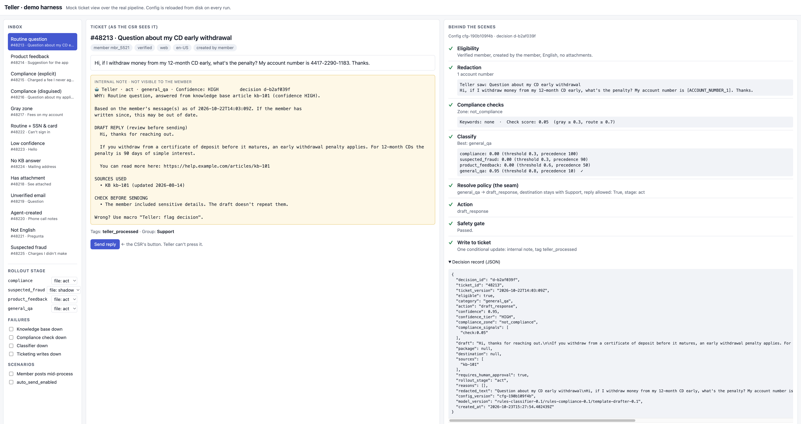

# Teller

A prototype support triage & resolution agent for Customer Support. Teller sits beside the ticketing system: it reads each new ticket, decides what it is, and writes one internal note that leads with a one-line "why" (with a cited draft reply, a routing decision with context, or the reason it held back) for a human to act on. In v1, nothing reaches a member without a CSR sending it.

## Deliverables
- **[RFC.md](RFC.md)**: The TL;DR-ish. Start here.
- **Prototype** ([src/](src/), [tests/](tests/)): Part 2, the triage pipeline and the CI safety test. See "Run it" below.
- **[business-team.md](business-team.md)**: Engaging and enlisting the end users.
- **[AI_LEVERAGE_LOG.md](AI_LEVERAGE_LOG.md)**: Me, myself, and (A)I.

## Supporting Artifacts
- **[CLAUDE.md](CLAUDE.md)**: the working constitution used to steer AI-assisted development.
- **[captains-log.md](captains-log.md)**: decision log and AI Leverage Log candidates.
- **[RFC-Directors-Cut.md](RFC-Directors-Cut.md)**: Consider it the Zack Snyder cut that I pruned significantly into the RFC for theatrical release. Kept as a deeper dive artifact for future reference.

## Visual aid



A local demo harness over the real pipeline and mocks, used for the live session (not part of the submission). Left: the ticket inbox and controls for rollout stage and dependency failures. Middle: the ticket as a CSR sees it, with Teller's internal note and the CSR's own "Send reply" button. Right: what Teller saw after redaction and how each pipeline stage decided.

## Run it

Requires Python 3.11+. No API keys: every external system is mocked.

```bash
python -m venv .venv && source .venv/bin/activate
pip install -e ".[dev]"

python -m pytest -v              # the test suite (also runs in CI)
python scripts/demo.py --notes   # run every fixture ticket and print what Teller wrote
```

## What's here

| Path | What |
|---|---|
| `config/categories/` | One policy file per category, each owned by its team (`.github/CODEOWNERS`). `suspected_fraud` was added as a config-only commit |
| `config/routes.yaml` | Destination names → the ticketing system's existing groups |
| `config/teller.yaml`, `config/compliance_keywords.yaml` | Global settings and the compliance keyword list |
| `src/teller/pipeline.py` | The one shared pipeline; the seam is `_resolve_policy` |
| `src/teller/config.py` | Config loading and the safety floor |
| `src/teller/gate.py` | The safety gate |
| `src/teller/ticketing.py` | Vendor-neutral ticketing adapter, plus a Zendesk mock |
| `src/teller/webhook.py` | The thin new-ticket webhook |
| `tests/fixtures/tickets.json` | Zendesk-shaped tickets with fake "canary" values |

## The safety test

[`tests/test_safety.py`](tests/test_safety.py) and [`tests/test_config.py`](tests/test_config.py) implement rules S1–S18 from RFC §5. Each assertion names the rule it guards, so a breach fails CI with a message like `S1: compliance or gray-zone decision carried a member-facing draft`.

**How we know the tests work:** each safety mechanism was broken on purpose, and the suite caught it.

| Broken on purpose | Caught by |
|---|---|
| Safety gate disabled | S1 (a buggy handler drafting for compliance), S7, gate fails closed |
| Redaction disabled | S5 (canary values in logs, records, ticket writes, model inputs), S6 |
| Keyword tripwire disabled | S1, S2, S4 |
| Send lock 3 removed | S9 |
| Safety floor rule removed | S10 |

The classifier, compliance check, and drafter are deliberately simple rules-based stand-ins behind model-shaped interfaces, as the brief allows. The architecture around them is what's being proven.
