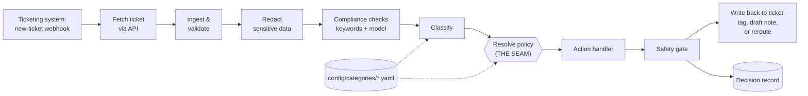

# RFC: Teller, a Support Triage & Resolution Agent

| | |
|---|---|
| **Status** | Draft |
| **Author** | _TODO: name_ |
| **Team** | AI Transformation Office, embedded with Customer Support |
| **Partners** | Customer Support lead, Compliance & Legal, Product, Forward Deployed Engineering |

---

## 0. Summary

Teller is a triage and resolution agent that sits **beside** Customer Support's ticketing system, not in front of it. For each new ticket it decides what the ticket is, then writes one internal note: a draft reply cited from the help center, or a routing decision with a context package for Product or Compliance & Legal. In v1 a CSR sends every reply. Every ticket goes through **one shared pipeline**; each category's policy is one config file owned by its team, and a new category (suspected fraud is in this repo as a config-only commit) needs no code. Safety is **structural**: redaction runs first, two independent compliance checks can only push toward Compliance, a safety gate and a config "safety floor" are enforced in code, and the ticketing integration can't reach a member. A CI test fails the build on any breach. Autonomy is **earned per category** (off → shadow → suggest → act), and if Teller fails, the ticket stays in the manual queue exactly as today. The most important open decision is where the compliance line sits, which belongs to Compliance & Legal (§0.3).

## 0.1 Context and the real bottleneck

Today every intake is read and handled by hand, so routine questions wait behind each other, and rare but important items (sharp product feedback, a complaint alleging a legal violation) get the same slow, inconsistent handling as everything else.

Leadership wants about 80% of intakes resolved through AI, *and* a human approving anything that reaches a member. Put together, **the 80% goal is limited by human review, not by the model.** At a few thousand intakes a day, CSRs would approve around 2,400 drafts; the difference between a 30-second and a 2-minute review is the difference between about 20 and 80 hours of CSR time a day (§4). So Teller's job isn't just to produce drafts. It's to make each approval fast and trustworthy: one note per ticket, cited sources, a confidence tier, and exactly what to check before sending (§3).

## 0.2 Assumptions

- **Ticketing system.** Support works in a ticketing system that can send webhooks and has a REST API. This RFC uses **Zendesk as the worked example**, but Teller is designed to be platform-agnostic: companies change ticketing systems when better products come along or after mergers, and Teller shouldn't need a rewrite when that happens. All vendor-specific detail lives in one adapter (see §3). The prototype mocks it.
- **Routing already exists.** Today an agent reads each intake and forwards it from inside the ticketing system, to a group, a view, or an integration that already reaches Product and Compliance & Legal. Teller performs that same step through the same mechanism. It doesn't build new routing.
- **Account issues are part of general Q&A.** Questions the knowledge base can answer are drafted. Questions whose answer depends on the member's own account data are escalated to a Support human.
- **Product feedback replies.** Whoever works the existing Product feedback queue sends the thank-you that Teller drafts.
- **The ticketing system stays the system of record.** Member data, conversation history, and the agent's working view all stay there. Teller adds to tickets and never replaces them.

_More to come as we go._

## 0.3 Open decisions

**Where is the compliance line? (Owner: Compliance & Legal. Most important open decision.)** The brief treats "compliance-sensitive" as if it were obvious. It isn't. "I'm reporting you to the CFPB" clearly is. "You charged me fees nobody ever told me about" might be a complaint about undisclosed fees, which is a regulatory concern, or it might be a routine fee question from a frustrated member. Working through the design showed how quickly this becomes a gray area, and it is a policy question, not an engineering one. Compliance & Legal should define the criteria, own the keyword list and the definition the compliance check uses, and label a sample of past tickets so the thresholds are set against their judgment.

Until they decide, Teller uses a **safe working default** (§2): explicit cases go to Compliance, gray cases go to a Support human with no draft and a "possible compliance" flag, and only clearly routine tickets get a draft. The design doesn't depend on where the line ends up. Moving it is a change to config and thresholds owned by Compliance, not a code change.

---

## 1. One pipeline, many categories

### Decision

Every intake goes through **one shared pipeline**. The pipeline answers a factual question: *what is this intake, and how sure are we?* A **per-category policy**, held in configuration, answers the business question: *given that, what do we do?* The model classifies. It never chooses the action.



| Stage | Shared or per-category | What it does |
|---|---|---|
| Webhook & fetch | Shared | The ticketing system notifies Teller that a ticket was created. The webhook carries only the ticket ID, and Teller fetches the full ticket through the API. See §3. |
| Ingest & validate | Shared | Parses the intake (member identity and claims, text, channel metadata) against a fixed schema, then runs the **eligibility check** (below). A malformed or ineligible ticket is left untouched in the manual queue, and the reason is recorded. |
| Redact | Shared | Replaces sensitive values with typed tokens (`[ACCOUNT_NUMBER_1]`) before any other stage sees the text. See §2. |
| Compliance checks | Shared | A keyword tripwire and a separate single-purpose model check, both independent of the classifier. Either can send the intake to Compliance (clear) or to a Support human with no draft (gray), whatever the classifier says. See §2. |
| Classify | Shared logic, **config-fed** | Returns `{category, confidence, rationale}`. It may only return a category ID that exists in config. Category descriptions and examples come from config. |
| **Resolve policy** | **The seam** | Looks up the category's policy and applies precedence rules: tripwire overrides, confidence below the category threshold escalates, and a category whose rollout stage is `off` goes to the manual queue. |
| Action handler | Shared code, **config-selected** | One of a small fixed set: `draft_response`, `route_with_package`, `escalate`. The policy picks which one runs and with what parameters. |
| Safety gate | Shared | Checks the proposed decision against the policy's invariants, in code. See §2. |
| Write back to ticket | Shared, adapter per system | v1: a member-facing draft is saved as an internal note on the ticket, and a human agent reviews and sends it. Routed tickets move to the destination queue named in config, carrying their context package. |
| Decision record | Shared | Append-only, redacted record of what was decided, why, and by whom. See §4 and Prototype §5. |

### Eligibility: tickets Teller leaves alone

Some tickets should never be processed. Teller checks each one at validate, using fields already on the ticket. The same conditions are also set in the ticketing system's webhook trigger, so most ineligible tickets never reach Teller, but Teller re-checks because the trigger lives in admin settings outside Teller's control.

| Ineligible when | Why |
|---|---|
| The member isn't verified (logged-in auth level) | The brief covers logged-in members. An email sender can be faked. |
| The ticket was created by an agent, not the member | Phone notes, internal tickets, and tickets created on a member's behalf aren't intakes. |
| It isn't in English | Out of scope for v1 (the brief excludes "every channel, language"). |
| It has attachments | v1 doesn't read attachments. A compliance concern or sensitive financial document could be inside one ("see the attached letter from my lawyer"). |

An ineligible ticket gets **no write at all**. It stays in the manual queue exactly as today, and Teller's decision record notes why. Because Teller sits beside the ticketing system (§3), stepping aside is always safe.

### Where the seam is, and why there

The seam sits at **policy resolution**, between "what is it" and "what do we do".

1. **It keeps the model out of the decision that can cause harm.** The worst a model error can do is put an intake in the wrong category. Misclassifying *into* compliance is safe, because it costs a human a few seconds. Misclassifying *out of* compliance is blocked by the tripwire, which the classifier can't override. If the model chose the action or the tools ("agentic" routing), safety would depend on the model behaving, which the brief rules out.
2. **It puts business policy where the business can own it.** Destinations, thresholds, and whether a category may ever draft a member response are decisions for Support, Product, and Compliance, not for engineers. In config they're readable, diffable, and reviewable by those owners. Each category lives in **its own file** (`config/categories/compliance.yaml`, and so on), and CODEOWNERS maps each file to its owning team, so a change to Compliance's policy needs Compliance's approval and can't ride along in someone else's edit. (CODEOWNERS works per file, which is why it's one file per category rather than one shared file.)
3. **It keeps safety logic in one place.** The alternative, a separate pipeline per category, copies redaction, gating, and audit into every pipeline. Each new category is then another chance to forget a safety check. With one pipeline, a new category gets every guarantee automatically.

### The v1 categories

The brief names four kinds of intake: routine questions, account issues, product feedback, and compliance concerns. v1 configures three categories and treats account issues as a rule inside general Q&A.

| ID | What belongs here | Action | Destination | Member reply | Threshold | Precedence |
|---|---|---|---|---|---|---|
| `compliance` | Alleges a legal or regulatory violation, unfair treatment, or discrimination; mentions regulators (e.g. CFPB), lawyers, or formal disputes | Route + flag | Compliance & Legal queue | **Never** | 0.3 (see §0.3) | 100 |
| `product_feedback` | Suggestions, feature requests, or praise or criticism of how a product or the site works | Route + summary + thank-you draft | Product feedback queue (existing route) | Thank-you only, sent by whoever works that queue | 0.6 | 50 |
| `general_qa` | Routine questions about products, rates, policies, or how-to, including account questions the knowledge base answers | Draft from the knowledge base | Stays with Support | Yes, sent by a CSR after review | 0.8 | 10 |

Two outcomes aren't categories, and both go to a Support human: **escalate** (no category fits, confidence is below the threshold, or the answer depends on the member's own account data) and **fallback** (a dependency failed; see §4).

- **Thresholds follow the cost of a mistake.** Compliance has the lowest bar of any category, and gray cases are held back from drafting (§2). Drafting a reply needs the most confidence, because a bad draft costs CSR trust. The values are placeholders, to be tuned against past tickets (whose outcomes show what CSRs actually did) before shadow mode starts.
- **Precedence settles mixed intakes.** "Your app is broken *and* this is illegal" goes to Compliance. See "Mixed intakes" below.
- **`suspected_fraud` is held back on purpose.** It's added after the build in its own commit, which adds one file, `config/categories/suspected_fraud.yaml`, and changes no code. The diff is the proof that a new category is configuration, not a rewrite. See "Adding a category" below.

**Account issues: escalate, don't guess.** An account question whose answer depends on this member's data ("why was my transfer held?") is escalated to a Support human instead of drafted. A model drafting answers about a specific account is how made-up facts reach members. General account questions that the knowledge base answers ("how do I reset my password?") are drafted as normal. A separate `account_issue` category would make reporting cleaner, but it isn't worth another category in v1.

**Product feedback gets a thank-you.** The member wrote in and expects an answer, so Teller routes the summary to Product and adds a short thank-you draft to the same note. Whoever works the Product feedback queue reviews and sends it. This is the one category where a route and a draft go together. It is handled by the routing handler adding a thank-you when the category allows a member reply, not by sending one intake down two paths (that's the deferred secondary-tags idea, below).

### What a category looks like

```yaml
- id: compliance
  description: >
    Complaints alleging a legal or regulatory violation, unfair treatment,
    discrimination, or demands involving regulators, lawyers, or formal disputes.
  action: route_with_package
  member_response_allowed: false     # enforced by the safety gate, not the prompt
  destination: compliance_legal_queue
  package_fields: [category, summary, alleged_issue, product_mentioned, intake_ref]
  confidence_threshold: 0.3          # lowest bar of any category; placeholder, see §0.3
  precedence: 100                    # wins any conflict
  rollout_stage: act                 # off | shadow | suggest | act | send (never for compliance)
  owner: compliance-legal
```

| Field | Purpose |
|---|---|
| `description`, examples | Fed to the classifier. A new category teaches the classifier about itself. |
| `action` | Which of the fixed handlers runs. |
| `member_response_allowed` | A hard invariant. If `false`, no member-facing text can leave the system for this category. |
| `destination` | The queue that receives the draft or the package. |
| `package_fields` | An **allowlist** of what the receiving team gets. Anything not listed is dropped. See §2. |
| `confidence_threshold` | Below this, the intake escalates to a Support human instead of acting. |
| `precedence` | Resolves conflicts when signals point to more than one category. |
| `rollout_stage` | How much autonomy this category has earned: `off`, `shadow`, `suggest`, `act`, or (after v1) `send`. Also the per-category kill switch. See §3. |
| `owner` | Who approves changes to this entry. |

### The safety floor: config can tighten, never loosen

Each category owns its policy, but some guarantees can't depend on a config line being right. A **safety floor in code** sits under every category file: config may make a category stricter than the floor, never looser. The config validator runs at load time and in CI, and refuses (so the deploy fails) any category file that breaks it:

- `compliance`, and any category the compliance tripwire can force a ticket into, must have `member_response_allowed: false`, and can never be set to `rollout_stage: send`.
- `compliance` must have the highest precedence and the lowest confidence threshold of any category, so nothing outranks it or slips past it.
- Every `package_fields` entry must be a field Teller knows how to build without sensitive values (see §2).

So a careless or malicious edit to `compliance.yaml` fails the build instead of reaching a member. (Built in the prototype, with a test that tries each forbidden setting.)

### Adding a category: suspected fraud

Adding fraud is one new category file, one line in `config/routes.yaml`, and one CODEOWNERS line. It needs no pipeline change. In this repo it is a separate commit ("Add suspected_fraud: configuration only") that touches nothing in `src/` or `tests/`; the full suite still passed and no existing fixture changed category:

```yaml
id: suspected_fraud
description: Member reports activity they don't recognize, an account takeover, or a stolen card.
hints: [fraud, unrecognized, didn't make, not me, stolen, hacked, someone else, account takeover]
action: route_with_package
member_response_allowed: false
destination: fraud_ops_queue
package_fields: [category, summary, intake_ref]
confidence_threshold: 0.3
precedence: 90
rollout_stage: shadow     # starts in shadow, like every new category
owner: fraud-ops
```

**What does need code:** a new *kind* of action (for example, "freeze the account"), a destination in a system with no adapter yet, or a new context-package field. (Each package field has a builder in code that uses redacted data only, so a new field is reviewed for what it could expose. The first draft of this example asked for a `reported_activity_type` field; building it showed that would have been a code change.) Both are deliberate: new powers and new integrations should get engineering review. New combinations of existing powers should not need it.

**Categories affect each other, and that's intended (described, not built).** The classifier sees every category at once, so adding `suspected_fraud` *should* take tickets that would otherwise land in `general_qa`: fraud reports that today get a routine answer. The risk isn't that categories interact. It's that a config change shifts tickets nobody meant to move. So any new or edited category runs a regression check against a labeled set of past tickets before it merges:

- Only tickets labeled for the new or changed category may move. Tickets labeled as anything else keep their category.
- Nothing ever moves *out of* compliance.
- The check prints the shift ("12 tickets moved from `general_qa` to `suspected_fraud`"), and the owners of every affected category approve it.

Shadow mode then measures the same shift on real tickets before the new category does anything visible.

### Mixed intakes and precedence

One intake can contain more than one thing, for example a routine question plus product feedback. In v1:

- Every intake gets **one primary category**, the highest-`precedence` category above its threshold, and that category determines the action.
- The safest category always wins. Compliance (100) beats fraud (90), which beats product feedback and general Q&A.
- **Deferred to v2:** secondary tags. For example, "answer the question *and* send a copy of the feedback to Product." This is useful, but it adds a fan-out path, and v1 should prove the single path first.

### Handoff to Forward Deployed Engineering

- Config schema validation at load time. A malformed category must stop the deploy, not fail at runtime.
- CODEOWNERS lines mapping each category file to its owning team (the prototype includes an example).
- Adapters for real destination queues (ticketing system, Product intake, Compliance case system).

---

## 2. Safety boundaries and data handling

### Decision

Safety comes from **structure, not from a prompt behaving**. Every guarantee is enforced in code by a layer that assumes the layers around it have failed. No single failure, whether a wrong model, a bad config edit, or a careless click, is enough to put an auto-generated answer in front of a member or member data somewhere it doesn't belong.

| # | Layer (pipeline order) | What it guarantees | Enforced by |
|---|---|---|---|
| 1 | Eligibility (§1) | Tickets Teller can't handle safely (attachments, unverified members, agent-created, non-English) are never processed | Validator in code |
| 2 | Redaction | Only the redactor ever reads raw member text | Pipeline order; CI canary test |
| 3 | Compliance detection | Compliance cases and gray cases never get a draft | Two independent checks; fail closed |
| 4 | Policy (§1) | The model never chooses the action; no config can let compliance reply | Seam at policy lookup; safety floor validator |
| 5 | Safety gate | No decision leaves Teller breaking its category's rules | Code checks on every decision |
| 6 | Ticketing adapter (§3) | Teller's writes can't reach a member in v1 | Write interface; `send_public_reply` behind three locks |
| 7 | Human approval | A CSR sends every reply in v1 | The ticketing system itself |
| 8 | CI safety test | Any breach of 1–6 fails the build | Automated test on every change |

### Data handling: redact first, then never copy

**Redaction is the first thing that touches the text.** Account numbers, card numbers, SSNs, and routing numbers are replaced with typed, numbered tokens (`[ACCOUNT_NUMBER_1]`) before any other stage runs. Everything after that, including the compliance checks, the classifier, the drafter, logs, and decision records, only ever sees tokens.

- **Member data never reaches the model provider.** Only redacted text is sent to any model.
- **No new copies.** The real values already live in the ticketing system, and the CSR sees them there. Teller doesn't keep its own store of them.
- **Logs carry IDs and decision fields, never text.** Ticket ID, decision ID, category, confidence, action, and timings. Not even redacted text goes into logs: redaction will miss things (an oddly formatted account number, an address, a member describing a medical bill), and logs are the most widely copied and widely readable place Teller writes. With no text in logs, a redaction miss has nowhere to leak, and the rule can be tested exactly. Debugging follows the ticket or decision ID to the access-controlled decision record or the ticket itself.
- **Traces follow the same rule as logs.** Spans carry IDs and timings only. This matters for AI systems in particular: LLM tracing and observability tools record full prompts and responses by default, which would quietly copy text into another vendor's system. Prompt and response capture is turned off; the decision record is the one place that holds what Teller read.
- **Context packages are built, not stripped.** A package for a receiving team is assembled field by field from the category's `package_fields` allowlist. Anything not listed is never added, so a new field can't leak by accident.
- **If redaction fails, Teller stops.** The ticket stays in the manual queue. Teller never skips ahead with raw text.
- **Member profile data (after v1; designed now).** The profile service holds most of what the brief calls "financial details, account specifics." When Teller starts using it (§3), it fetches an **allowlist of fields**: account flags (open dispute, legal hold, fraud hold, deceased) and product types. Never balances, account numbers, or transaction details, because Teller has no use for them. These fields are labels, not sensitive values, so they may inform the classifier and drafter, but they follow the same rules as everything else: never in logs or traces, never in a context package unless that category's `package_fields` allowlists them, and never quoted in a draft.

**Why redaction runs before the compliance checks:** compliance keywords ("CFPB", "lawyer") aren't the patterns redaction replaces, so they survive it. Running redaction first means no later stage, including the compliance checks and what they record, can ever quote a raw account number. The CI test includes a compliance complaint that contains an account number, to prove it still reaches Compliance.

### Detecting compliance: two independent checks, and a gray zone

_Working default. Where the line sits is open and owned by Compliance & Legal (§0.3)._

- **Keyword tripwire.** A deterministic list of words and patterns (regulators, lawyers, lawsuits, discrimination, and so on), owned by Compliance in its own file. It can't be talked out of a match and doesn't depend on a model, but it misses paraphrases.
- **Compliance check.** A separate, single-purpose model call: "Does this allege unfair, deceptive, discriminatory, or illegal treatment, or threaten legal or regulatory action?" It catches paraphrases and implied complaints. It is deliberately separate from the main classifier, so a confused classifier doesn't take it down too.
- **Both only push toward compliance.** Either check can move a ticket into compliance or into the gray zone; neither can move one out.
- **Three outcomes, not two:**
  - *Clear* (a keyword match, or a high compliance score): route to Compliance & Legal.
  - *Gray* (a middling score, e.g. "fees nobody told me about"): leave with a Support human, **no draft**, with a "possible compliance" flag in the note.
  - *Clear of compliance*: continue to normal classification.
- **If the compliance check fails or times out, there is no draft.** An unclear compliance answer never becomes a routine reply.

The score bands are placeholders until Compliance & Legal set the line.

### The safety gate: checked twice, in code

The gate runs on every decision after the action handler, and doesn't trust the handler:

- **No draft where no reply is allowed.** For a category with `member_response_allowed: false`, the handler never produces a draft, *and* the gate rejects any decision that carries one anyway. A bug in one is caught by the other.
- **No redaction tokens in a draft.** Drafts are written from redacted text, so a draft could say "your account [ACCOUNT_NUMBER_1]…", and a hurried CSR might send it. The gate rejects any draft containing a token.
- **Links only to approved destinations.** A draft may link only to approved domains and knowledge-base articles (see prompt injection below).
- **Only allowlisted fields in a package.**
- **What a rejection does:** the ticket goes to a Support human with no draft, and the decision record notes which rule failed. The gate fails closed: an error inside the gate itself is treated as a rejection.

### Prompt injection

_Described, not built in the prototype._ Member text reaches the drafting model, so a member could try to steer it. The design limits the damage: the model never chooses the action or the destination (§1), so an injection can at most distort a draft, and in v1 a human reviews every draft before it's sent. The remaining risk, a draft carrying a phishing link or false instructions, is checked on the *output*, not the input: the safety gate allows links in a draft only to approved domains and knowledge-base articles. Scanning the input for phrases like "ignore previous instructions" is a denylist that is easy to get around, so it would be a hint at most, never the protection.

### Proving it: the CI safety test

The brief asks for a breach to fail automatically, not to depend on someone noticing. The test suite runs every fixture through the full pipeline against mock dependencies. The fixtures contain fake **canary** values (account numbers, SSNs) that must never appear anywhere. The build fails if:

- **any compliance or gray-zone fixture produces a member-facing draft**, including when a deliberately misbehaving mock classifier labels it routine and returns a draft;
- **a canary value appears in any output Teller produces**: logs, decision records, ticket notes, context packages, or anything sent to the model;
- **with v1 config, any member-visible write happens** at all;
- **a config that breaks the safety floor loads** (each forbidden setting is tried);
- **an adapter exposes a member-visible write** other than the locked `send_public_reply`, or that method can be reached for a compliance ticket under any configuration.

Fixtures cover a routine question, product feedback, an explicit compliance complaint, a **disguised** compliance complaint with no keywords (caught by the compliance check), a compliance complaint containing an account number (caught after redaction), and a gray-zone case. Failure messages name the broken rule ("compliance decision carried a member-facing draft"), so a reviewer can read the safety model from the test output.

### If something slips through anyway

**Detect.**
- In v1 the CSR is the last check, because every reply is sent by a human.
- Every decision has a redacted decision record: category, confidence, which compliance checks fired, config version, model version, and the ticket version Teller read. "Why did this ticket get a draft?" has an answer.
- CSRs can flag a bad decision with one macro (§3). Broader monitoring, such as sampling sent replies or alerting on compliance terms in replies, is in the deferred logging and reporting work.

**Contain.**
- Per-category switch (`rollout_stage: off`), Teller's global switch, and Support's own webhook kill switch (§3). Each leaves tickets in the manual queue.
- Known limitation: drafts already posted aren't withdrawn (§3).

**Recover.**
- Query decision records by category, config version, or model version to find every affected ticket, and hand the list to Compliance.
- **Every miss becomes a fixture.** A synthetic ticket that reproduces the failure is added to the CI safety test, so the same miss fails the build from then on. (Synthetic, not the real ticket: real member tickets, even redacted, don't belong in a code repository.) Over time, as Compliance & Legal rule on gray cases, the fixtures also become a written record of where the compliance line sits (§0.3).

### Handoff to Forward Deployed Engineering

- A production-grade redaction service (more data types, tested against real ticket samples) in place of the prototype's patterns.
- Log and tracing configuration that enforces "IDs, not text" at the platform level too, including prompt capture turned off in any LLM observability tool.
- Model provider terms: no training on Teller's data, minimal retention.
- Retention policy for decision records, agreed with Compliance.

## 3. Extending the workflow, not replacing the safety net

### Built new, wrapped, left alone

Teller adds one service and a few settings to the ticketing system. Everything Support relies on today keeps working, and when Teller is off, nothing about the manual process has changed.

| | What | Notes |
|---|---|---|
| **Built new** | The Teller service: pipeline, compliance checks, classifier, handlers, safety gate | Shared code (§1, §2) |
| | Category config files, safety floor validator, CODEOWNERS | Owned by the business (§1) |
| | Decision record store | The only place that holds what Teller read and why (§2) |
| | Webhook endpoint and ticketing adapter | The only vendor-specific code (below) |
| | Settings in the ticketing system: the new-ticket trigger, a Teller service account, the "Teller: flag decision" macro | Configured by the Support admin, not code |
| **Wrapped** (read through an adapter, never changed) | **Ticketing and case system** | Reads tickets; writes only an internal note, the `teller_processed` tag, and a group move (below) |
| | **Help-center knowledge base** | Read-only, through its existing search; no ingestion in v1. Drafts cite the articles they used. No answer means escalate, never invent. Teller never edits articles. (Below.) |
| **Left alone** | The manual queue and the CSR's workflow | Still the default for every ticket Teller skips, escalates, or can't reach |
| | **Member profile service** | Not called in v1. Teller uses only the identity and claims already on the ticket. See "The member profile service, after v1" below. |
| | Existing groups, routing rules, triggers, macros, and SLAs | Teller uses the existing routes; it doesn't create new ones (§0.2) |
| | Knowledge base authoring and ownership | Gaps Teller finds are reported, not filled by Teller |
| | What Compliance & Legal and Product do after a handoff | Teller delivers the ticket with context; their processes don't change |
| | The member-facing channels (web form, help center) | Members see no difference in v1 |

### Using the knowledge base without ingesting it

Support answers routine questions from the help center today, and Teller's drafts should come from the same place. Only the `draft_response` handler uses the knowledge base; classification, routing, and compliance don't need it.

```
redacted text → KB adapter: search(query) → top few articles
             → drafter writes only from those articles, citing them
             → safety gate: cites a retrieved article? links only to those articles?
```

- **Wrap the existing search, don't ingest.** Building Teller's own index (chunking, embeddings, keeping it in sync as articles change, evaluating retrieval) is a project of its own. v1 calls the help center's existing search API through a KB adapter with one method, `search(query)`. Like the ticketing adapter, it is the only vendor-specific part.
- **No article, no draft.** If no article is relevant enough, Teller escalates to a human with "no KB answer found" in the note. This is the "never fabricate an answer" guarantee, and it makes weak search a *usefulness* problem, not a safety problem: a missed article costs an escalation, not a made-up reply.
- **Every draft cites its sources.** The gate rejects a draft that cites no retrieved article or links anywhere else. Whether a draft is faithful to its article can't be fully checked in code; in v1 the CSR checks it, and the note shows the source to make that quick.
- **Stale articles are the bigger risk.** Knowledge bases drift out of date. Today an experienced CSR often knows an article is wrong and works around it. With Teller, a stale article becomes a confident, well-written draft *with a citation*, which looks more trustworthy, not less, and it reaches more members faster. So:
  - **Show the article's age, and warn when it's old.** The note shows each source's last-updated date, and "Check before sending" warns when an article is older than a set age (for example, six months).
  - **Never quote time-sensitive numbers.** Rates, APYs, and fees change constantly. A draft links to the live source instead of stating a figure, and if the answer *is* the figure, Teller escalates.
  - **Check knowledge base health before general Q&A leaves shadow.** Shadow mode shows which articles Teller would rely on most. Their owners review those first, before `general_qa` moves to `suggest`. That makes the KB owners stakeholders in the rollout and turns an unknown risk into a launch checklist item.
  - Later, in the logging and reporting work: articles behind drafts that CSRs often rewrite or flag go on a "possibly outdated" list for their owners.
- **Public help center only in v1.** Help-center articles are written for members, so quoting them is safe. Internal policy docs may contain things members shouldn't see, so adding them needs its own review.
- **If the knowledge base is down, no draft** (§4). There is no safe fallback: without a source, any draft would be invented.
- **When to build ingestion: when the numbers say so.** Decision records show how often general Q&A escalates with "no KB answer." If that rate is what stands between Teller and the 80% goal, a proper retrieval index is the next investment for Forward Deployed Engineering. If the gap list shows missing or outdated articles instead, the fix is content work for the KB owners, and Teller has told them exactly where.

_Prototype: a mock knowledge base of a few fake articles with keyword lookup, and a test that a question with no matching article escalates with no draft. The rest is described, not built._

### The member profile service, after v1

v1 doesn't call the member profile service. Teller works only from the identity and claims already on the ticket (authenticated upstream). That keeps v1 to one fewer integration and one fewer source of member data. The profile service is the most valuable addition after v1, for two reasons:

- **Safety: knowing when *not* to draft.** The profile can show flags the ticket text doesn't reveal: an open dispute or complaint, a legal hold, a fraud hold, a deceased-member flag. A member with an open dispute who asks an innocent-sounding question shouldn't get a routine draft. Any such flag would mean no draft, and the ticket goes to a human. It's a second compliance signal that has nothing to do with wording.
- **Drafting: picking the right article.** Products held tell Teller whether "my CD" means a 12-month CD or a no-penalty CD, so it can choose the right knowledge base article.

**Accepted v1 risk:** without those flags, a member with an open dispute who writes a routine-sounding question could get a routine draft. In v1 that is covered by the compliance checks and by a CSR reviewing every reply, who sees the member's history in the ticketing system. It is one reason `send` is not part of v1: auto-sending should wait until the profile flags are in place.

**The cost to the 80% goal, stated plainly.** The brief lists account issues as one of the four main kinds of intake, and most of them ("why was my transfer held?", "when does my CD mature?") can only be answered with the member's own data. v1 escalates every one of them to a human. That is safe, but it caps how far v1 can get toward 80%. Shadow mode measures what share of intakes are account-specific, and that number decides the first investment after v1. If it is large, and it probably is, profile integration comes first.

When it's added, it follows the data rules in §2 (an allowlist of flags and product types, never balances or account numbers) and the failure behavior in §4, both designed now.

### Teller sits beside the ticketing system, not in front of it

Tickets are created exactly as they are today. Teller learns about each new ticket, reads it, and writes its decision back onto the ticket. It never sits between the member and the ticketing system.

**Why:** if Teller is down, slow, or wrong about whether to act, the ticket stays in the manual queue and is handled the way it is today. When Teller does nothing, that's always safe. The manual process isn't something Teller has to protect, because Teller never stands between a member and it.

### How Teller learns about new tickets

**Built in the prototype:**

1. **Webhook.** The ticketing system POSTs `{ticket_id}` to Teller when a ticket is created. Teller verifies the signature, accepts the event, and processes it.
2. **Thin payload, fetch on read.** The webhook carries no member data. Teller fetches the ticket through the API, so member data never sits in the webhook layer or its logs, and Teller always reads the ticket's current state.
3. **Back off if a human got there first.** Before writing back, Teller re-reads the ticket. If an agent has already picked it up or answered it, Teller adds a note at most and changes nothing else.
4. **Process each ticket once.** Teller skips any ticket already tagged `teller_processed`. That one check handles duplicate webhook deliveries *and* stops Teller's own write-back from looping if a trigger fires on updates.

**Documented, handed to Forward Deployed Engineering:**

| Gap | Why it matters | What we'd build |
|---|---|---|
| Durable queue behind the webhook | The webhook should acknowledge quickly and absorb bursts. Work in progress shouldn't be lost if a worker crashes. | Webhook handler publishes to a queue (SQS, or a Kafka topic if Bankrate already runs Kafka). Workers consume from it. |
| Missed webhooks | Vendors drop webhooks during outages or Teller deploys, and stop retrying after a few attempts. | A scheduled sweep every few minutes queries the API for recent tickets with no Teller tag and enqueues them. |
| Backlog | During a large burst, a late draft is worse than none. | Tickets waiting longer than a threshold are skipped and left in the manual queue. |
| Follow-up messages | v1 handles new tickets only. A member can add a message after Teller's note is posted, for example raising a compliance concern in a second message. | v1 relies on the version stamp in the note and on a human sending every reply (see below). Next: rerun the compliance tripwire when a member adds a message to a Teller-touched ticket. |

**Why at-least-once delivery is good enough:** a ticket Teller never sees is handled manually, exactly as today. The sweep is there for *coverage*, not *safety*, so Teller doesn't need exactly-once delivery.

### How Teller writes to a live system

The ticketing system is where Support works all day. Teller is a guest in it, and it should behave like a careful colleague, not a bot with admin rights. The webhook only brings news *in*. Every read and write goes through the ticketing API, behind one adapter.

```
Ticketing ──webhook {ticket_id}──▶ Teller     "a ticket was created"
Ticketing ◀──API: read ticket──── Teller     "show me the ticket"
Ticketing ◀──API: update ticket── Teller     "here's my decision"
```

**The biggest risk lives here.** In a Zendesk-class system, a *public* comment is emailed to the member. The call that saves Teller's draft as an internal note is one flag away from sending an unapproved answer. So:

- **Teller's everyday writes can't reach a member.** Its normal write interface is limited to: add an internal note, add tags, and move the ticket to a group. Only a human agent, in the agent's own tool, sends a member-facing reply. In v1, this *is* the approval gate.
- **The one member-visible write is locked away.** `send_public_reply` exists so that the `send` stage (see the rollout plan) can be enabled through configuration later without rewriting anything. It sits behind three locks, all checked in code on every call, and all three must be open: the global `auto_send_enabled` switch (off in v1, changes need sign-off from both Compliance and the Support lead), the category's `rollout_stage` is `send`, and the category has `member_response_allowed: true`. The last lock means compliance can never auto-send, whatever else is configured. (Prototype: the CI safety test asserts that with v1 config no member-visible write ever happens, and that no configuration lets a compliance-flagged intake reach `send_public_reply`.)
- **The tradeoff, stated plainly:** we gave up "Teller is unable to post a public reply" for "Teller can't post one unless three locks are deliberately opened, and never for compliance." We accepted that so that reaching auto-send later is a reviewed config change rather than a rebuild.

**Rules for being a good guest:**

| Rule | Why |
|---|---|
| **A dedicated Teller service account**, with the lowest role that can add notes, tags, and change groups. | Every change shows "Teller" in the ticket history, so agents always know what the AI did versus what a person did. Support admins can exclude Teller's account from existing triggers. |
| **Small, reversible writes only.** Notes, tags, group moves. Never change status, priority, requester, or SLA fields. Never close or solve a ticket. | Status changes can start SLA clocks or send member emails through existing triggers. Anything Teller does can be undone by an agent in one click. |
| **One note per ticket.** The draft, the category, the confidence, and why go into a single note. | Agents scroll these tickets all day. Comments can't be edited after posting, so a second "correction" note is clutter. |
| **One update, all or nothing.** The note, any group move, and the `teller_processed` tag go in a single ticket update. | A partial write could tag a ticket as processed while its note failed, and the tag would then block a retry. One update means the ticket is either fully handled or untouched. |
| **Only write to the version Teller read.** The update is conditional on the ticket not having changed since Teller read it. If it changed (the member posted again, an agent picked it up, it was moved), the update is rejected; Teller re-reads and reprocesses, at most twice, then leaves the ticket to a human. | Covers the race where a member posts several times in quick succession, and guarantees Teller never overwrites a concurrent human change. One rule instead of a list of edge cases. |
| **Review existing triggers and automations with the Support admin before go-live.** | Teller's tags and group moves can fire rules nobody remembers writing. This is a launch checklist item, not a code problem. |
| **Stay within an API budget.** Reserve a share of the account's rate limit for Teller, back off on `429`, and never compete with the agents' own tools or other integrations. | Rate limits are usually shared across the whole account. Teller during a burst must not slow down the humans. |

**Teller decides; the ticketing system routes.** Routing a ticket means doing what an agent does today: moving it to the group that already handles that work. The ticket then shows up in that team's existing queue, with Teller's note explaining why. Teller has no routing UI and no new paths to other teams. If Product feedback reaches Product today through an existing view or integration, Teller sends it the same way. A category's `destination` is just the name of an existing route, mapped to the vendor's group ID inside the adapter.

**The adapter is the only part of Teller that knows which vendor it's talking to.** It's a second seam, at the edge of the system, just like the category config is a seam in the middle.

| The adapter's contract (vendor-neutral) | What stays inside the adapter (vendor-specific) |
|---|---|
| `get_ticket(id) -> Intake`: turns the vendor's ticket into Teller's own `Intake` model | Webhook signature scheme and secret |
| `add_internal_note(id, text)` | API endpoints, auth, pagination, rate-limit headers |
| `add_tags(id, tags)` | Custom field IDs mapped to member ID, auth level, products |
| `move_to_group(id, destination)` | How "internal note" and conditional update are expressed |
| `send_public_reply(id, text)`: locked behind the three checks above; unreachable in v1 | Mapping config destinations (e.g. `compliance_legal_queue`) to the vendor's group IDs, read from `config/routes.yaml` |

Moving from Zendesk to Salesforce Service Cloud, Freshdesk, or whatever a merger brings means writing one new adapter and re-mapping destinations. The pipeline, category config, safety gate, and tests don't change. And the CI safety test runs against the adapter contract, so a new adapter can't expose any member-visible write other than the locked `send_public_reply` without the build failing.

### What Teller writes to the ticket

Two things, nothing more:

**1. The tag `teller_processed`.** It marks every ticket Teller touched, so Support can filter and report on Teller-touched tickets in the ticketing system's own tools. It is also the idempotency and loop guard. It reveals nothing about Teller's decision, so it's safe to add even in blind shadow mode.

**2. One internal note** (at `suggest` and `act`). Human review is the bottleneck, so the note is designed to make one approval fast and trustworthy:

```
🤖 Teller · suggest · General Q&A · Confidence: HIGH        decision d-48213-01
Based on the member's message(s) as of 2:03 PM. If the member has written
since, this draft may be out of date.

DRAFT REPLY (review before sending)
  Hi Dana, if you withdraw from a 12-month CD before it matures, the
  penalty is 90 days of simple interest...

WHY
  Routine question about CD early-withdrawal rules. No complaint or
  regulatory language found.

SOURCES USED
  • KB: "CD early withdrawal penalties" (updated 2026-08-14)

CHECK BEFORE SENDING
  • The member included an account number. The draft doesn't repeat it.
  • The draft gives the general penalty rule. It can't reflect this
    member's specific CD terms; confirm them in the account if needed.

Wrong? Use macro "Teller: flag decision".
```

- **Sources** let the CSR check one KB article instead of checking the facts from scratch.
- **Confidence is a tier** (HIGH, MEDIUM, LOW), not a raw score that means nothing to a CSR.
- **"Check before sending"** brings up what a careful reviewer would look for: sensitive data, gaps caused by a failed dependency, anything unusual.
- **The version stamp** tells the CSR exactly which messages the draft is based on. Anything the member writes later appears below the note, and in v1 a human sends every reply, so the human catches it. At `send`, Teller applies the same rule itself: it sends only if the ticket hasn't changed since the draft was made.
- **The rationale is a sentence or two**, not the model's reasoning. Full detail lives in Teller's decision record, linked by the decision ID.
- For routed tickets, the same note carries the context package for the receiving team, built from the category's `package_fields` allowlist (§2).

**Never written:** a public comment (in v1; see `send` below), a status or priority change, raw sensitive values, or the model's full reasoning.

**Measuring Teller-touched tickets.** Teller compares the reply the CSR actually sent with its own draft (unchanged, lightly edited, or rewritten) and notices when a CSR re-routes a ticket Teller routed. The "flag decision" macro gives CSRs a one-click way to object. These signals feed the promotion and demotion rules in the rollout plan below.

**Deferred:** more tags or Teller-owned custom fields for richer reporting in the ticketing system; suggesting an existing macro instead of a free-text draft. Filling in an existing "contact reason" field, if Support has one, is deliberately left to the CSR in v1: that human-chosen value is the independent answer key that shadow-mode agreement is measured against. It could be enabled at `act` for promoted categories later, as a mapping in the adapter.

**The kill switch belongs to Support.** The quickest way to stop Teller is to turn off the webhook trigger in the ticketing system's admin settings. The Support lead can do that without engineering, and tickets simply stay in the manual queue. Teller also has its own global and per-category switches (`rollout_stage: off`). See the rollout plan below.

**Known limitation: the kill switch doesn't take back drafts already posted.** Stopping Teller stops new notes, but drafts already in internal notes on open tickets can still be sent by a CSR. In v1 this is covered by human review of every reply. Withdrawing open drafts when Teller is stopped (for example, a "Teller paused, don't use earlier drafts" note) is not built.

**Data stays where it already lives.** When a ticket is routed to a group inside the ticketing system (for example, the Compliance queue), the context package is a note on the same ticket, so no new copy of member data is made. The allowlisted package (§2) matters most when a destination is *outside* the ticketing system, such as Product's backlog tool.

### Rollout: autonomy is earned per category

Teller starts out doing nothing on a CSR's behalf. It earns each step with evidence, one category at a time, and drops back a step automatically when the evidence turns bad.

| `rollout_stage` | What Teller does | What the CSR sees | What it proves |
|---|---|---|---|
| `off` | Nothing | Nothing | |
| `shadow` | Decides and records the decision privately | **Nothing** | Does Teller agree with what CSRs actually did on the same tickets? |
| `suggest` | Posts one internal note: category, draft, "suggest routing to X" | A suggestion to use or ignore | Do CSRs accept it? Is the draft sent unchanged, lightly edited, or rewritten? |
| `act` | Routes and tags on its own; places the draft ready to send | Work already done. Routing can be undone in one click; every reply is still sent by a CSR | Does it hold up without a human doing the step first? |
| `send` _(after v1)_ | Sends the reply to the member itself | Sent replies, sampled for review | Not for v1. Only for categories that have proven themselves at `act` |

- **Shadow is blind on purpose.** If CSRs see Teller's answer, they lean on it, and Teller's accuracy can no longer be measured on its own. Blind shadow gives a clean baseline at no cost to CSRs.
- **Routing and replies climb separately.** Routing never reaches a member and is reversible, so it can reach `act`. In v1, a reply never leaves without a human sending it, at any stage. That is leadership's v1 requirement.
- **`send` is possible, deliberate, and never for compliance.** It is the top rung, after v1, so the route to the 80% goal doesn't need a rebuild. Enabling it for a category is a configuration change, not a code change, but it is the riskiest change in the system, so it is deliberately hard to do by accident: it requires the global `auto_send_enabled` switch (Compliance and the Support lead both sign off), a category that allows member replies (compliance and fraud never do), and stricter evidence. For example: drafts sent unchanged at least 98% of the time over several weeks at `act`. Once on, sent replies are sampled for review, and any bad send demotes the category to `act` automatically.
- **Order by how cheap a mistake is, not by volume.** Routing *into* Compliance can be promoted early, since a wrong guess costs Compliance a few seconds. General Q&A drafts come later, since a bad draft costs CSR trust. Within a stage, a share of volume (for example, 10% of general Q&A) caps the damage if something goes wrong.
- **Promotion is a business decision, backed by evidence.** The Support lead approves each step. It's a config change on an entry with an `owner`, so CODEOWNERS enforces it. Criteria are agreed up front with the CSRs, including the skeptics. For example: shadow → suggest at ≥90% agreement over a few hundred tickets with zero missed compliance cases; suggest → act when acceptance stays above an agreed level for several weeks.
- **Demotion is automatic.** If CSR overrides pass a threshold, or a single compliance case is missed, the category drops a stage without anyone having to decide.
- **Teller never routes a ticket *away* from Compliance**, at any stage.

**Why stage by category first, then volume:** the risk of a mistake differs far more between categories than between tickets in the same category. Routing a ticket into Compliance and drafting a reply to a member are different kinds of risk and earn trust at different speeds, so each category climbs on its own evidence. Volume caps within a stage then limit how many tickets a surprise can touch.

**A likely first sequence** (timings depend on the evidence, not the calendar):

1. **All categories in `shadow`** for a few weeks, while the team agrees on promotion criteria, Compliance & Legal settle the compliance line (§0.3), and the KB owners review the articles Teller relies on most.
2. **Compliance and product feedback routing to `suggest`, then `act`.** A wrong route is cheap, reversible, and never reaches a member. This is also where Support first sees Teller help, by taking forwarding work off their plate.
3. **General Q&A drafts to `suggest`**, starting with a share of volume and the most common, best-documented questions.
4. **General Q&A to `act`** once acceptance holds. This is where most of the 80% goal comes from.
5. **`send` is not part of v1.**

## 4. Degraded mode and throughput

### Decision

Because Teller sits beside the ticketing system (§3), **doing nothing is always safe**: a ticket Teller doesn't touch stays in the manual queue, exactly as today. So every failure has the same destination, a human, and the only design question is how much useful context Teller can still add on the way. Teller never guesses to fill a gap: no source means no draft, and an unclear compliance answer means no draft.

### When a dependency is slow or down

Every call has a timeout. A dependency that keeps failing is skipped for a cool-down period (a circuit breaker), so a slow service causes fast fallbacks instead of a pile-up.

| Dependency | If it's slow or down | What still works |
|---|---|---|
| **Model provider** (compliance check, classifier, drafter) | Compliance check fails: **no draft**; the ticket stays with a Support human. Classifier fails: escalate. Drafter fails: escalate. | The keyword tripwire needs no model, so explicit compliance tickets still reach Compliance. |
| **Knowledge base search** | **No draft.** Without a source, any draft would be invented (§3). | Classification and routing; product feedback and compliance routing don't need the knowledge base. |
| **Ticketing API: read** | Teller can't see the ticket, so it writes nothing. The ticket stays in the manual queue. | Everything is retried later (queue and sweep, §3); missing a ticket is safe. |
| **Ticketing API: write** | The single update is all or nothing (§3), so a failure leaves the ticket untouched. Retry at most twice, then leave it. On rate limiting (`429`), back off. | No half-written tickets. |
| **Member profile service** | _After v1; see below._ | |

**What a failure looks like on the ticket: nothing.** When a dependency fails, Teller writes nothing and records the reason in its decision record. A note saying "Teller couldn't help" adds clutter without helping the CSR, who handles the ticket as today. Notes are reserved for cases where Teller has something useful to say (below).

### When confidence is low

- **Below the category's threshold:** escalate. At `suggest` and above, Teller adds its note without a draft: its best guess at the category, and why it's unsure. That still saves the CSR some reading.
- **Compliance gray zone:** no draft, with a "possible compliance" flag in the note (§2).
- **No knowledge base answer:** no draft, with "no KB answer found" in the note (§3).
- **Never:** a draft below threshold, a draft for a gray-zone case, or a low-confidence compliance case resolved as routine.

### Throughput and bursts

- **Teller's own load is small.** A few thousand intakes a day is a couple a minute on average; even a tenfold burst is modest. The webhook only puts the ticket ID on a queue, workers process at their own pace, and the queue absorbs bursts (§3). Model and ticketing API rate limits are the real ceiling, and each has a budget.
- **Late is worse than never.** A ticket that has waited in Teller's queue longer than a threshold is skipped and left to the manual queue (§3). During a large burst, Teller gracefully does less instead of falling behind.
- **The real throughput limit is human review.** At 80% of 3,000 intakes a day, CSRs approve about 2,400 drafts. At 30 seconds each, that's about 20 hours of CSR time a day; at 2 minutes each, 80 hours. How fast a CSR can trust and approve a draft matters more to the 80% goal than anything about Teller's infrastructure. That is why the note leads with the draft, its sources, a confidence tier, and exactly what to check (§3).


**Member profile service (after v1; designed now).** v1 doesn't call it, so it can't fail in v1. When it's added: if it is slow or down, any draft that depends on account data escalates to a human, the note says account flags couldn't be checked, and the ticket can never reach `send` without a successful flag check. A routine knowledge-base answer that doesn't depend on the member's account can still be drafted.

## 5. Prototype contract

The build spec for the prototype, compiled from §1–§4. The category config schema is the YAML in §1.

### What goes in: `Intake`

The ticketing adapter turns the vendor's ticket into this. Nothing past the adapter knows which vendor it came from.

```python
class Member:
    member_id: str
    auth_level: str            # "verified" required (eligibility, §1)
    products: list[str]        # claims from the ticket, authenticated upstream

class Intake:
    ticket_id: str
    ticket_version: str        # vendor's updated_at; the conditional update checks it (§3)
    member: Member
    channel: str               # "web", "email", ...
    subject: str
    body: str                  # raw text: only the redactor reads it (§2)
    created_by_member: bool    # eligibility
    has_attachments: bool      # eligibility
    language: str              # eligibility
    created_at: datetime
```

### What comes out: `Decision`

The brief's response shape (category, action, draft or package, confidence, approval) plus what's needed to explain the decision later. A `Decision` is also the decision record. It never holds raw text.

```python
class Decision:
    decision_id: str
    ticket_id: str
    ticket_version: str                  # the version Teller read
    eligible: bool
    category: str | None                 # an ID from config/categories/, or None
    action: Literal["draft_response", "route_with_package", "escalate", "none"]
    confidence: float | None
    confidence_tier: Literal["HIGH", "MEDIUM", "LOW"] | None
    compliance_zone: Literal["clear", "gray", "not_compliance", "unknown"]
    compliance_signals: list[str]        # e.g. ["keyword:cfpb", "check:0.82"], never quoted text
    draft: str | None                    # member-facing; redacted; never for compliance or gray
    package: dict | None                 # built from the category's package_fields only
    destination: str | None              # an existing route name, mapped to a group by the adapter
    sources: list[str]                   # knowledge base article IDs the draft cites
    requires_human_approval: bool        # always True in v1
    rollout_stage: str
    reasons: list[str]                   # why: "below_threshold", "kb_unavailable", "gate:token_in_draft", ...
    config_version: str
    model_version: str
    created_at: datetime
```

**Who approved it** lives in the ticketing system: the CSR who sent the reply, and when. The decision record joins to it by `ticket_id`. Together they answer the brief's question: why this intake was answered, routed, or escalated, and who approved it.

### What Teller writes: one `TicketUpdate`

```python
class TicketUpdate:
    ticket_id: str
    if_version: str            # rejected if the ticket changed since Teller read it (§3)
    internal_note: str | None
    add_tags: list[str]        # only ["teller_processed"]
    move_to: str | None        # destination name
```

One update per ticket, all or nothing. The adapter's write interface accepts only this. `send_public_reply` exists but is locked (§3).

### The rules, as tests

Each rule is a test in `tests/test_safety.py` or `tests/test_pipeline.py`. A failing test names the rule it broke.

| # | Rule | From |
|---|---|---|
| S1 | No compliance or gray-zone decision ever carries a draft, even when the classifier misbehaves and returns one | §2 |
| S2 | A keyword match always makes the ticket compliance, whatever the classifier says | §2 |
| S3 | A disguised compliance complaint with no keywords is caught by the compliance check | §2 |
| S4 | If the compliance check fails, there is no draft, and keyword-matched compliance still routes to Compliance | §2, §4 |
| S5 | No canary value appears in logs, decision records, ticket updates, packages, or anything sent to a model | §2 |
| S6 | A compliance complaint containing an account number still reaches Compliance (redaction doesn't hide it) | §2 |
| S7 | The gate rejects any draft containing a redaction token | §2 |
| S8 | With v1 config, no member-visible write ever happens | §2, §3 |
| S9 | No configuration lets a compliance ticket reach `send_public_reply` | §3 |
| S10 | Every config that breaks the safety floor fails to load | §1 |
| S11 | The ticketing adapter exposes no member-visible write except the locked one | §3 |
| S12 | An ineligible ticket gets no write at all | §1 |
| S13 | If the ticket changed between read and write, the update is rejected; Teller reprocesses at most twice, then leaves it | §3 |
| S14 | A ticket already tagged `teller_processed` is skipped | §3 |
| S15 | No matching knowledge base article, or the knowledge base is down: no draft | §3, §4 |
| S16 | Below the category's threshold: no draft | §4 |
| S17 | `off` writes nothing; `shadow` writes only the `teller_processed` tag (no note, no move) | §3 |
| S18 | Every category's destination is an existing route; an unknown one fails at load | §3 |

Plus the three required paths through one pipeline: a routine question gets a draft, product feedback is routed with a summary and a thank-you draft, and a compliance complaint is routed with no draft.

**Described, not built:** the prompt-injection link check (§2), the category regression check (§1), the member profile service (§3), the durable queue and sweep (§3), measuring agreement and promotion (§3).

### What building it changed

The prototype was built from this contract, and building it corrected the design in a few places:

- **Routes were hard-coded.** The first adapter mapped destination names to Zendesk group IDs in code, so adding fraud would have needed a code change. The mapping moved to `config/routes.yaml`, and a destination that isn't a known route now fails at load (S18). This was found while preparing the config-only fraud commit, which is the point of making that commit.
- **Package fields are code, on purpose.** See "What does need code" in §1.
- **Escalations with no category needed a rollout stage.** It is now an explicit setting (`uncategorized_stage`), not an implicit default.
- **A keyword match can sit next to a low compliance-check score.** Correct (either check alone is enough), but confusing for a Compliance reader, so the note now says so.
- **Shadow mode's write was ambiguous.** S17 now says exactly what shadow writes: the `teller_processed` tag and nothing else.
- **The safety test was itself tested.** Each safety mechanism (gate, redaction, keyword tripwire, send lock, safety floor) was removed on purpose; each removal failed the right tests (see README).

### Repo layout

```
config/categories/        one YAML file per category (§1)
config/routes.yaml        destination → the vendor's existing groups (§3)
.github/CODEOWNERS        category file → owning team
src/teller/               pipeline, redaction, compliance checks, classifier, handlers, gate,
                          adapters (ticketing, knowledge base), webhook endpoint
tests/                    test_safety.py, test_pipeline.py, test_config.py
tests/fixtures/           Zendesk-shaped tickets with canary values
```

## 6. Bringing the business team along

_Working with the Customer Support lead and two experienced agents, one of whom is skeptical that AI should touch member conversations at all._

**Define "good" with them, in their words.** Before Teller drafts anything, the three of them label a sample of past tickets: what category it was, what should have happened, and what a good reply looked like. That becomes a short rubric for a good resolution (accurate, cited, right tone, no guessing about the member's account) and the labeled set Teller is measured against. The skeptic's objections are the most useful input here; each one becomes a rule, a threshold, or a test case.

**Validate together, blind first.** In shadow mode the CSRs see nothing, and Teller's decisions are compared with what they actually did. Once a week we review the disagreements together. Each one ends in one of three places: Teller was wrong (fix config or thresholds), the knowledge base was wrong (send it to its owner), or the team itself was inconsistent (settle it, write it down). The team sees Teller get corrected by them.

**Earn trust where Teller takes work off their plate, not where it speaks for them.** Routing comes first: forwarding feedback and compliance tickets is tedious, never reaches a member, and is easy to undo. Drafts come later, on a share of volume, for the best-documented questions. Promotion criteria are agreed up front, with the skeptic, and each step needs the evidence, not faith. Objecting is cheap (one "flag decision" macro) and has consequences (overrides demote a category automatically), so pushback visibly changes the system.

**Hand off ownership so it sticks.** The Support lead owns the general Q&A and product feedback config files (CODEOWNERS), the promotion decisions, and the kill switch in the ticketing system's own settings, with no engineering needed. The weekly disagreement review becomes the team's ritual, with the skeptic as its quality reviewer. Forward Deployed Engineering owns the code. The handoff has worked when the review runs without me.

**Where I'd expect friction.** Fear that Teller is a step toward replacing them, or toward measuring them on approval speed (it shouldn't be: speed targets turn review into rubber-stamping). Drafts that sound generic or wrong for Bankrate's tone. Notes that clutter tickets. Compliance & Legal getting more gray-zone noise than they'd like. The skeptic's core worry, that member conversations deserve a human, is right, and v1 keeps it true: no reply leaves without a CSR. **Along, not around:** give the skeptic the pen on the rubric and the promotion bar, and let the evidence, not me, make the case.

## 7. What I'd do next with more time

In rough priority order:

1. **Settle the compliance line with Compliance & Legal** (§0.3): their criteria, keyword list, and labeled gray cases, then tune the bands.
2. **Member profile service** (§3): account flags (open dispute, legal hold) as a second, non-wording compliance signal, and the path to resolving account issues, likely the biggest gap to 80%. Data and failure rules are already designed (§2, §4).
3. **Logging and reporting:** shadow-vs-CSR agreement, draft edit rates, a permanent blind holdout, rubber-stamping signals, and a "possibly outdated" article list for KB owners. Most outcome reporting can come from the ticketing system itself, compared on `teller_processed`.
4. **Real models behind the existing interfaces,** with an evaluation set built from the labeled tickets, and the regression check for category changes (§1).
5. **Production plumbing for FDE:** durable queue and sweep behind the webhook, a production redaction service, the prompt-injection link check (§2), and log and tracing configuration.
6. **Follow-up messages:** rerun the compliance checks when a member adds a message to a Teller-touched ticket.
7. **Knowledge base ingestion,** only if "no KB answer" escalations turn out to be what stands between Teller and 80% (§3).
