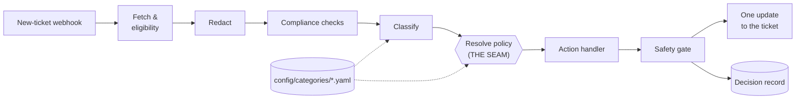

# RFC: Teller, a Support Triage & Resolution Agent

| | |
|---|---|
| **Status** | Draft |
| **Author** | Joel Sadler |
| **Team** | AI Transformation Office, embedded with Customer Support |
| **Partners** | Customer Support lead, Compliance & Legal, Product, Forward Deployed Engineering |

_A longer version with the full reasoning behind each decision is in [RFC-Directors-Cut.md](RFC-Directors-Cut.md)._

---

## 0. Summary

Teller sits **beside** Customer Support's ticketing system, not in front of it. For each new ticket it decides what the ticket is and writes one internal note: a draft reply cited from the help center, or a routing decision with context for Product or Compliance & Legal. In v1 a CSR sends every reply. Every ticket goes through **one shared pipeline**; each category's policy is a config file owned by its team, so a new category needs no code. Safety is **structural**: enforced in code and proven by a CI test, not dependent on a prompt. Autonomy is **earned per category**, and if Teller fails, the ticket stays in the manual queue exactly as today.

### 0.1 The real bottleneck

80% resolved by AI *plus* human approval of everything that reaches a member makes **human review the limit, not the model.** At a few thousand intakes a day, CSRs would approve about 2,400 drafts; a 30-second versus a 2-minute review is the difference between about 20 and 80 CSR-hours a day. So Teller's job is to make each approval fast and trustworthy.

### 0.2 Assumptions

A ticketing system with webhooks and an API (Zendesk as the worked example; the design is vendor-neutral). Routing to Product and Compliance already exists inside it, and Teller uses those routes. The ticketing system stays the system of record.

### 0.3 Open decision: where is the compliance line?

"I'm reporting you to the CFPB" clearly is compliance; "fees nobody ever told me about" might be. That's a policy call for **Compliance & Legal**, not engineering, and the most important open decision. Until they set it, gray cases get **no draft** and go to a human with a "possible compliance" flag. Moving the line later is a config change Compliance owns.

---

## 1. One pipeline, many categories

**Decision.** One shared pipeline answers *"what is this, and how sure are we?"* A per-category policy in config answers *"what do we do?"* The model classifies; it never chooses the action.



**Why the seam is at policy resolution:**
1. **The model stays out of the decision that can cause harm.** Its worst error is a wrong category, and misclassifying *out of* compliance is blocked by compliance checks the classifier can't override.
2. **The business owns its policy.** Destinations, thresholds, and whether a category may ever reply are Support, Product, and Compliance decisions. Each category is its own file with its own CODEOWNERS line, so Compliance approves changes to Compliance's policy.
3. **Safety lives in one place.** Everything else is shared code, so a new category inherits every safety guarantee. Config only *selects* one of three fixed handlers (draft, route, escalate) and its settings.

| Category | Action | Destination | Member reply | Confidence threshold |
|---|---|---|---|---|
| `compliance` | Route with flag | Compliance & Legal | **Never** | 0.3 (lowest) |
| `product_feedback` | Route with summary + thank-you draft | Product feedback queue | Thank-you only | 0.6 |
| `general_qa` | Draft from the knowledge base | Stays with Support | Yes, sent by a CSR | 0.8 |

The threshold is the confidence needed to apply the category's action, set by the cost of a mistake: lowest for compliance so it fires easily, highest for drafting a reply. Precedence sends mixed intakes to the safest category. So a complaint that also makes a sharp product point goes to Compliance. Losing that product point would be a waste of exactly the rare, valuable item the brief calls out, so a later version would also tag the ticket for Product, with a summary only once Compliance clears it (described, not built). Anything below threshold, matching no category, or needing the member's own account data is **escalated** to a human. Tickets Teller can't handle safely (unverified member, agent-created, non-English, attachments) get a short note saying why and nothing else.

**Adding a category is configuration.** Suspected fraud was added in one commit touching only config: a category file, a route, a CODEOWNERS line. No code changed, every test passed, no existing ticket changed category, and it starts in shadow. Code is needed only for a new *kind* of action, a new system to integrate, or a new handoff field, each of which deserves engineering review.

**The safety floor: config can tighten, never loosen.** A validator refuses to load any config that lets compliance reply or auto-send, lets another category outrank compliance, or adds a handoff field Teller can't build safely. A careless edit to `compliance.yaml` fails the build instead of reaching a member.

---

## 2. Safety boundaries and data handling

**Decision.** Safety comes from **structure, not from a prompt behaving.** Each layer is enforced in code and assumes the others have failed.

| Layer | Guarantees |
|---|---|
| Eligibility | Tickets Teller can't handle safely are never processed |
| Redaction | Only the redactor reads raw member text |
| Compliance checks | Compliance and gray cases never get a draft |
| Policy + safety floor | The model never chooses the action; no config lets compliance reply |
| Safety gate | No decision leaves Teller breaking its category's rules |
| Ticketing adapter | Teller's writes can't reach a member in v1 |
| Human approval | A CSR sends every reply in v1 |
| CI safety test | Any breach of the above fails the build |

**Data handling.**
- **Redaction runs first.** Account, card, and Social Security numbers become tokens before anything else reads the text, so they never reach a model, a log, or a handoff. (The prototype catches number patterns only; names and addresses need a production redaction service before any real model is connected.)
- **No text in logs or traces, not even redacted.** Redaction will miss things, and logs are the most widely copied place Teller writes. The access-controlled decision record is the one place that holds what Teller read.
- **Handoffs are built from an allowlist,** field by field, never by stripping fields out.

**Detecting compliance: two independent checks.** A **keyword tripwire** owned by Compliance (can't be talked out of a match, needs no model) and a separate **single-purpose model check** that catches paraphrases. Either can push a ticket toward compliance; neither can pull one out. Clear cases route to Compliance; gray cases get no draft and a flag. **If the check is unavailable, no draft.**

**The safety gate** runs on every decision and doesn't trust the handler. It rejects a draft for a category that can't reply, a draft containing a redaction token, and an *answer* draft citing no knowledge base source. Product feedback's thank-you is a different kind of draft: a fixed acknowledgment template, not generated and never containing member text, so it needs no source; it still passes every other gate check. An error inside the gate counts as a rejection.

**Prompt injection.** Member text reaches a model, so a member could try to steer it. The design already limits what that can do: the model never chooses the action, and no model output can pull a ticket out of compliance. So the worst outcomes are a wrong category (and the dangerous one, out of compliance, is blocked) or a distorted draft, which a CSR reviews before it's sent. Checking that a draft's links point only to approved destinations is further hardening (§7), not the main defense.

**Proving it.** Test tickets carry fake **canary** values. The build fails if a compliance or gray ticket gets a draft (even when a deliberately broken classifier calls it routine), a canary appears in logs, records, ticket writes, or model inputs, any member-visible write happens with v1 config, or a config that breaks the safety floor loads. Each safety mechanism was removed on purpose to confirm the right tests fail.

**If something slips through.** *Detect:* the CSR reviews every reply; every decision has a record of why; CSRs flag a bad decision with one click (§3). *Contain:* per-category, global, and Support-owned kill switches each return tickets to the manual queue. *Recover:* decision records find every affected ticket, and **every miss becomes a test case**, so it can't quietly happen again.

---

## 3. Extending the workflow, not replacing the safety net

| | What |
|---|---|
| **Built new** | The Teller service and its config. In the ticketing system, settings only: a trigger, a low-privilege service account, and a one-click "flag decision" macro for CSRs. |
| **Wrapped** | **Ticketing system:** read tickets; write only a note, a tag, and a group move. **Knowledge base:** read-only, through its existing search. |
| **Left alone** | The manual queue and CSR workflow; existing routes, triggers, and SLAs; knowledge base authoring; what Compliance and Product do after a handoff. **Member profile service:** not used in v1 (below). |

**Beside, not in front.** Tickets are created exactly as today; Teller reads them and writes back. If Teller is down, slow, or unsure, the ticket sits in the manual queue. **Doing nothing is always safe**, so a missed webhook costs coverage, not safety.

**Writing to a live system.** In a Zendesk-class system a *public* comment emails the member, so that's the biggest risk. Teller's writes are limited to an internal note, a tag, and a group move, in **one update that only applies if the ticket hasn't changed since Teller read it**. It never changes status or SLA fields. The one member-visible write, for a post-v1 auto-send stage, is **locked behind three checks** (a global switch Compliance and Support must both approve, the category at that stage, and the category allowing replies), and compliance can never pass the third. Only the adapter knows the vendor, so switching ticketing systems means one new adapter.

**One note for every outcome,** leading with a one-line "why," so a CSR never wonders whether Teller looked:

```
🤖 Teller · suggest · general_qa · Confidence: HIGH
WHY: Routine question, answered from knowledge base article kb-101.
DRAFT REPLY (review before sending): Hi, if you withdraw from a 12-month CD early...
SOURCES: kb-101 (updated 2026-08-14)
CHECK BEFORE SENDING: the member included sensitive details; the draft doesn't repeat them.
```

Each part of the note exists to make the 30-second review in §0.1 possible: the WHY line says what Teller did, dated sources let the CSR check one article instead of the facts, and "check before sending" points at exactly what to look at.

Other outcomes say so plainly: *"Compliance concern. Routed to Compliance & Legal. No reply drafted."* or *"Teller couldn't finish: the knowledge base was unavailable."* Nothing is posted in shadow or when Teller is switched off.

**Knowledge base: wrap the existing search, don't ingest.** No article means no draft, so weak search costs usefulness, not safety. The bigger risk is **stale articles** becoming confident, cited drafts: the note shows each source's age, and KB owners review the most-used articles before general Q&A leaves shadow.

**Member profile service: after v1, and what that costs.** It's the only way to answer **account issues** ("why was my transfer held?"), one of the brief's four intake types, and its account flags (open dispute, legal hold) would be a second compliance signal. v1 escalates every account-specific question, which **caps how far it gets toward 80%**. Shadow mode measures that share; it likely makes the profile service the first investment after v1.

**Rollout: autonomy is earned per category.**

| Stage | What Teller does | What the CSR sees |
|---|---|---|
| `shadow` | Decides privately | **Nothing** |
| `suggest` | Posts its note | A suggestion to use or ignore |
| `act` | Routes on its own; draft ready to send | Work done; routing undone in one click; a CSR still sends every reply |
| `send` _(after v1)_ | Sends the reply itself, behind three locks | Never for compliance |

- **Shadow is blind on purpose,** so Teller's accuracy is measured against CSRs working unaided.
- **Stage by category, then volume.** Risk differs more between categories than within one. Routing (cheap, reversible, never reaches a member) goes first; general Q&A drafts, where most of the 80% comes from, go last.
- **Promotion is a business decision backed by evidence,** with criteria agreed up front with the team; the Support lead approves each step. **Demotion is automatic** when overrides pass a threshold or a compliance case is missed.
- **Measuring it** _(described, not built)_: a nightly job compares Teller's decision with what the CSR actually did, using the ticket's history: was the draft sent unchanged, edited, or rewritten; was a routed ticket moved back; was it flagged. Sending a draft unchanged is the thumbs-up; the flag is the thumbs-down with a reason. In shadow, that comparison *is* the agreement score.
- **Support owns the kill switch:** turning off the webhook trigger stops Teller, no engineering needed.

---

## 4. Degraded mode and throughput

**Decision.** Because Teller sits beside the ticketing system, **every failure ends at a human**, and Teller never fills a gap with a guess: no source means no draft, and an unclear compliance answer means no draft.

| If this is down | What happens |
|---|---|
| Model provider | No draft. The keyword tripwire needs no model, so explicit compliance still reaches Compliance. |
| Knowledge base | No draft; routing still works |
| Ticketing API | Nothing written (or nothing half-written); the ticket stays manual |

**Low confidence** (below threshold, a gray compliance score, or no KB answer) also means no draft, with a note saying why. **Throughput** is modest (a couple of intakes a minute); a queue absorbs bursts, and a ticket that waits too long is left to the manual queue, because a late draft is worse than none. Timeouts and the queue are described, not built; the fallbacks are built and tested.

---

## 5. Prototype contract

The prototype implements one shared pipeline over three data shapes: **`Intake`** (what the ticketing adapter produces), **`Decision`**, and **`TicketUpdate`** (Teller's only everyday write: a note, a tag, an optional group move). `Decision` is the brief's response contract, and also the decision record:

```python
class Decision:
    ticket_id: str
    category: str | None                 # an ID from config/categories/, or None
    action: Literal["draft_response", "route_with_package", "escalate", "none"]
    draft: str | None                    # never for compliance or gray zone; a CSR sends it
    package: dict | None                 # handoff context, built from the category's allowlist
    destination: str | None              # an existing route in the ticketing system
    confidence: float | None
    confidence_tier: Literal["HIGH", "MEDIUM", "LOW"] | None
    requires_human_approval: bool        # always True in v1
    compliance_zone: Literal["clear", "gray", "not_compliance", "unknown"]
    sources: list[str]                   # knowledge base articles the draft cites
    reasons: list[str]                   # why: "below_threshold", "kb_unavailable", ...
    redacted_text: str | None            # what Teller read; never raw text
    config_version: str
    model_version: str
    # Approval: filled in by the nightly comparison with the CSR (§3).
    # Not built: these fields are not in the prototype's model, and stay empty until the sync exists.
    approved_by: str | None              # the CSR who sent the reply or kept the routing
    approved_at: datetime | None
    outcome: Literal["sent_unchanged", "edited", "rewritten", "rerouted", "flagged"] | None
```

**Explaining a decision later.** *Why* is everything above the approval block, kept in an access-controlled store. *Who approved it* is the approval block: the ticketing system already records who sent each reply, and the nightly comparison (§3) copies that onto the decision record. **The gap, stated plainly:** that sync isn't built, so in the prototype "who approved it" lives only in the ticketing system. Records are kept as long as the ticket itself (a proposed default for Compliance to confirm). Full schemas for all three shapes are in the Director's Cut.

**The rules, as tests:**

| # | Rule |
|---|---|
| S1 | No compliance or gray-zone decision carries a draft, even with a misbehaving classifier |
| S2 | A keyword match always makes the ticket compliance |
| S3 | A disguised complaint with no keywords is caught by the compliance check |
| S4 | Compliance check down: no draft, and keyword-matched compliance still routes |
| S5 | No canary value appears in logs, decision records, ticket writes, packages, or model inputs |
| S6 | A complaint containing an account number still reaches Compliance |
| S7 | The gate rejects any draft containing a redaction token |
| S8 | With v1 config, no member-visible write ever happens |
| S9 | No configuration lets a compliance ticket reach `send_public_reply` |
| S10 | Any config that breaks the safety floor fails to load |
| S11 | The adapter exposes no member-visible write except the locked one |
| S12 | An ineligible ticket gets only an explanatory note |
| S13 | If the ticket changed between read and write, Teller re-reads, then gives up |
| S14 | A ticket already processed is skipped |
| S15 | No matching article, or the knowledge base down: no draft |
| S16 | Below the category's threshold: no draft |
| S17 | `off` and `shadow` write nothing at all |
| S18 | Every destination is an existing route, or config fails to load |

**Why no real model call.** The classifier, compliance check, and drafter are rules behind model-shaped interfaces, as the brief allows. That proves safety better than a live call: the tests *force* the bad cases on every run (a broken classifier, a buggy handler, a drafter leaking a token, every dependency failing), where a real model misbehaves rarely and unpredictably. A real model would plug in behind the same interface and pass through the same gate. What this doesn't prove is how real models fail in practice; that's the first item in §7.4.

**Building it changed the design.** Preparing the config-only fraud commit exposed routes hard-coded in the adapter, which moved to config. And after seeing it run, every outcome now gets a note: the first version stayed silent on failures, leaving CSRs unsure whether Teller had looked at all.

---

## 6. Bringing the business team along

Part 3 of the brief is a separate document: [business-team.md](business-team.md).

---

## 7. What I'd do next with more time

1. **Settle the compliance line** with Compliance & Legal, then tune the checks against their labeled cases.
2. **Member profile service:** account flags as a second compliance signal, and the path to resolving account issues.
3. **The comparison with the CSR** (§3), then agreement and edit-rate reporting and a permanent blind holdout.
4. **A real model behind the drafter first,** with structured, cited output, bad output treated as a failed dependency, and recorded responses so tests stay deterministic; then an evaluation set from the labeled tickets.
5. **Production plumbing for Forward Deployed Engineering:** a durable queue, production redaction, the prompt-injection link check, and log and tracing configuration.
